# 📈 Learner Growth Analytics on Real Data — Funnel, Cohort Retention & Early-Engagement Signals (OULAD)


A growth / product-analytics case study on the **real Open University Learning Analytics Dataset** (32,593 enrolments, 10.6M VLE interaction rows). It maps a SaaS-style funnel onto learning (**Registered → First VLE activity → First assessment → Passed**, with withdrawal as churn), measures cohort retention by presentation, tests for an early-engagement "magic moment" and turns the results into growth experiments for a K-10 EdTech like **Edumaths360**.

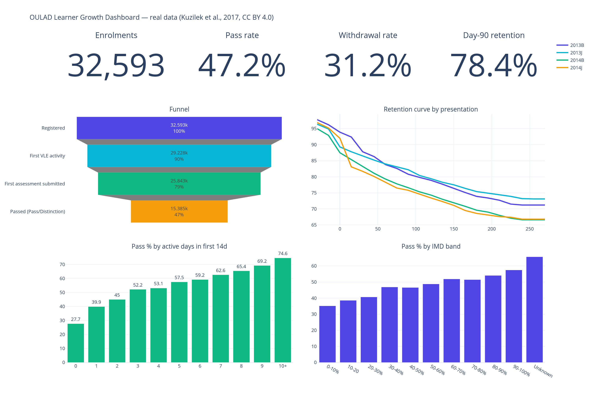

## 💡 Headline findings (real data)

| Question | Answer |
|---|---|
| Biggest funnel leak? | **After the first assessment**: 40.5% of submitters don't pass. Activation is about 90% |
| When does churn happen? | **Half of withdrawals by day 30**, with 26.6% before the module even starts |
| Feb vs Oct cohorts? | **About the same** (D90 78.1% vs 78.6%). 2014 cohorts retain about 5 pts worse than 2013 |
| Magic moment? | No sharp cliff, a steady dose-response: **0 → 10+ active days in the first 14 days = 27.7% → 74.6% pass**. Sharpest threshold: **first assessment score ≥ 60** (33% → 57% pass) |
| At-risk segments? | 2+ previous attempts (27.5% pass), most-deprived IMD band (35.2%), no formal qualifications (29.7%) |

➡️ Full write-up with experiments: **[REPORT.md](REPORT.md)**. Unit economics are a **clearly separated hypothetical layer** (`assumptions/`), because OULAD has no revenue or spend data.

## 📊 Charts

| | |
|---|---|
| 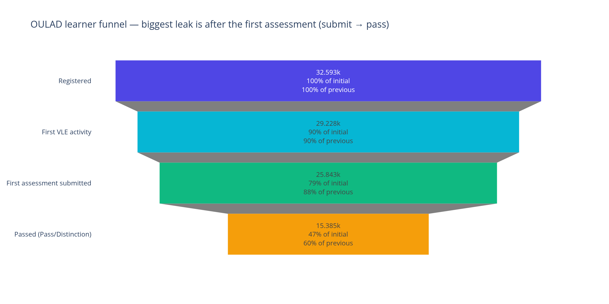 | 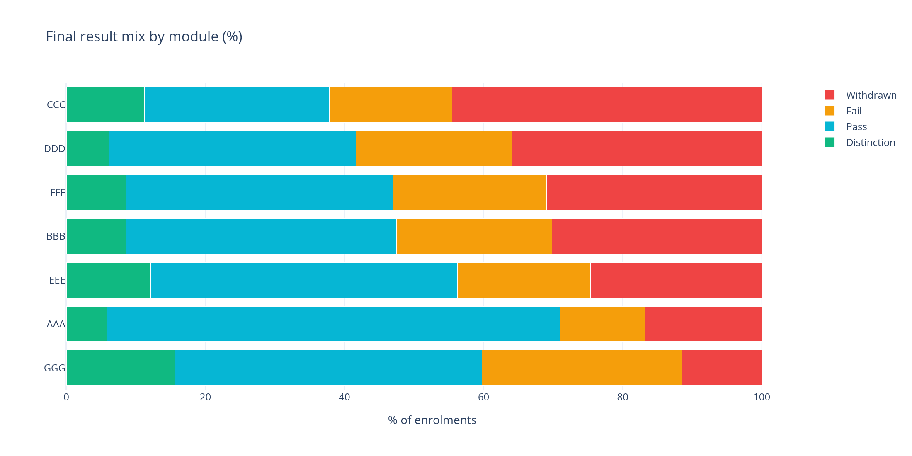 |
| 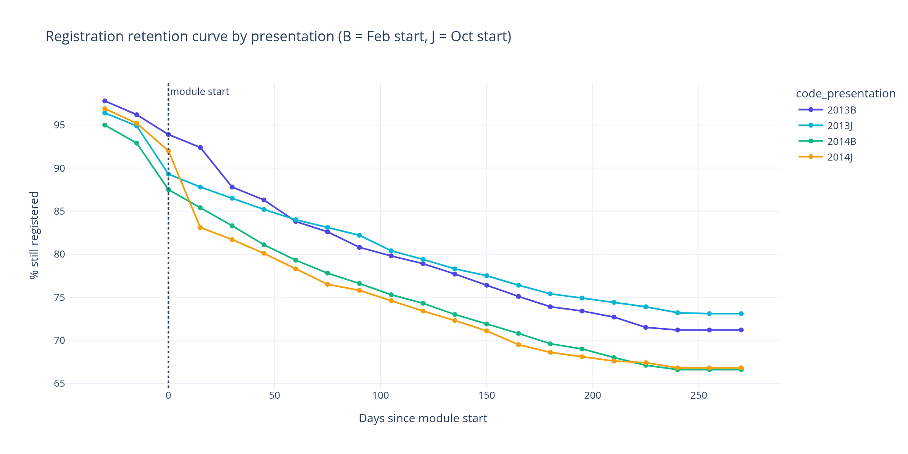 | 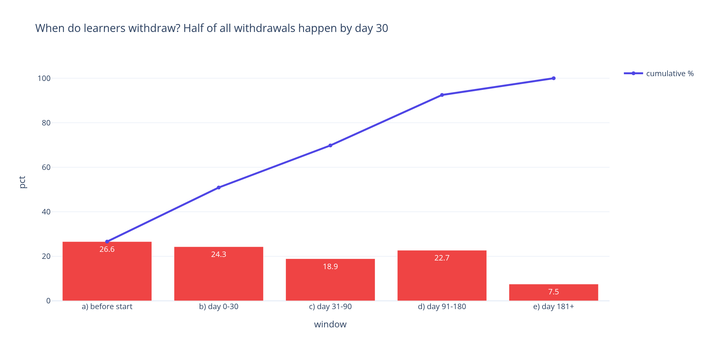 |
| 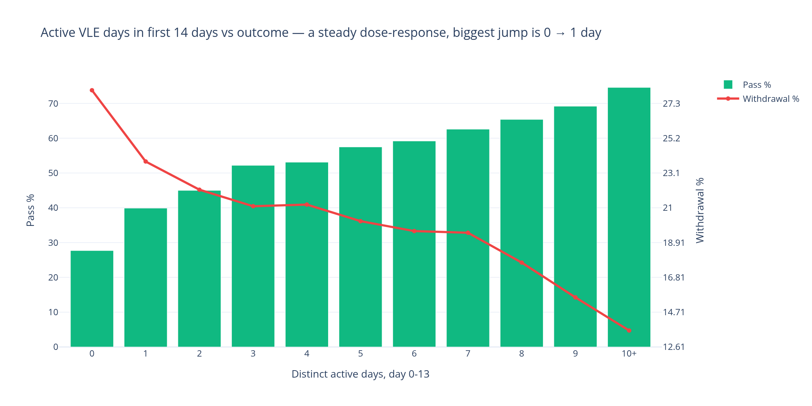 | 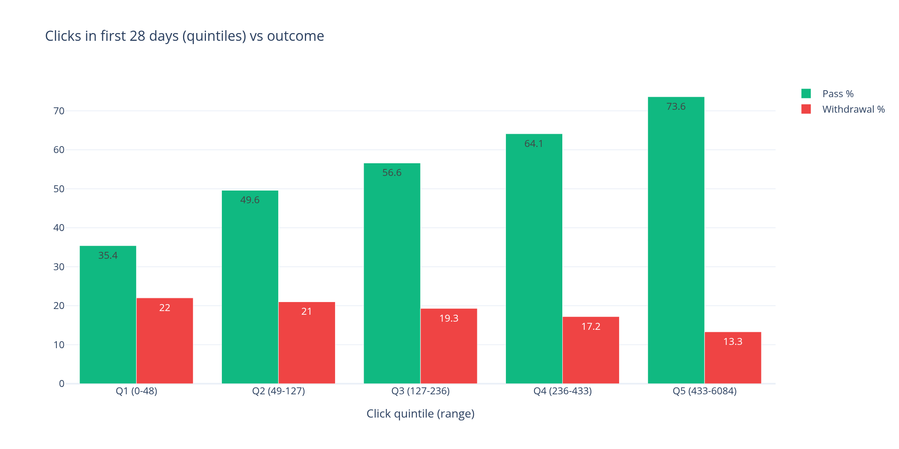 |
| 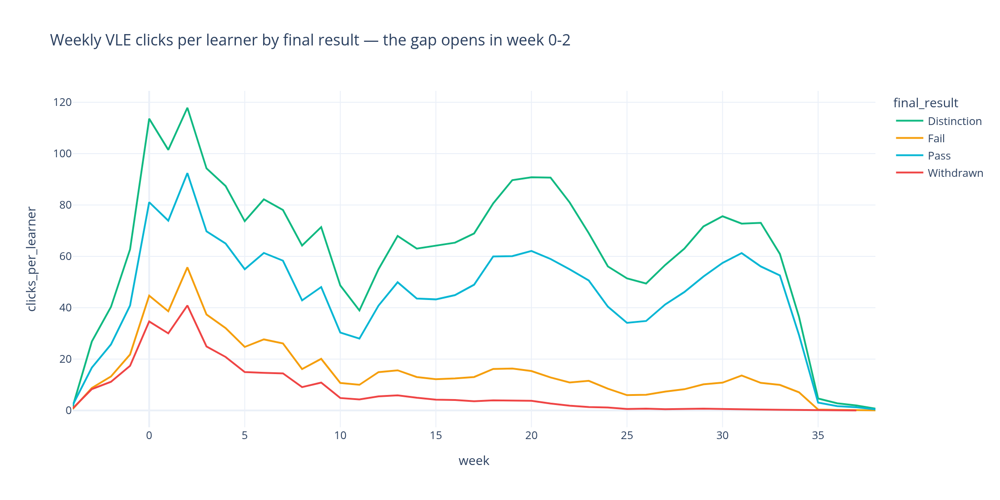 | 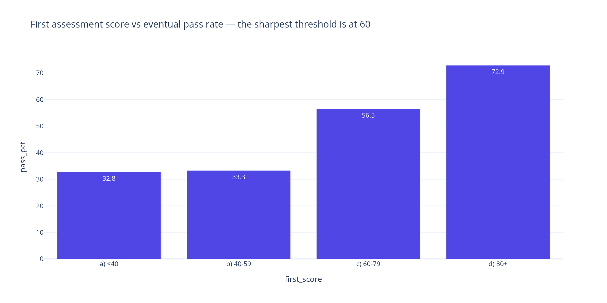 |
| 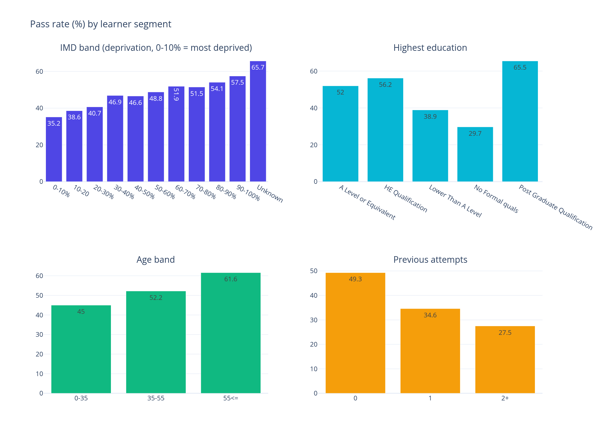 | 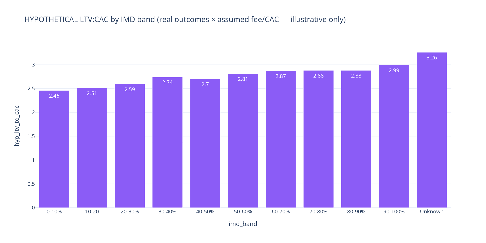 *(hypothetical)* |

> The dashboard is a Power BI-style layout **built in Plotly**. There is no `.pbix` file; the derived CSVs load straight into Power BI or Tableau.

## 🚀 How to run
```bash
pip install -r requirements.txt
python data/download_oulad.py   # about 47 MB zip → data/raw/ (about 450 MB unzipped, git-ignored)
python data/build_derived.py    # aggregates 10.6M VLE rows → data/student_journey.csv (about 5 s)
python sql/run_queries.py       # loads into SQLite, runs all 15 queries
cd notebooks && jupyter nbconvert --to notebook --execute --inplace exploratory_analysis.ipynb
# or: make all
```
The committed derived CSVs mean you can skip the first two steps. Exporting PNGs uses Kaleido v1, which needs Chrome/Chromium.

## 🧠 SQL highlights
- `sql/funnel_conversion.sql`: funnel with `LAG`/`FIRST_VALUE`, leak `RANK()`, `SUM() OVER ()` result mix, module funnels, 5-dimension segment table with `PARTITION BY` ranks and gaps from the average, registration-timing buckets.
- `sql/cohort_retention.sql`: D0/30/60/90/180 retention by presentation, Feb vs Oct, a `WITH RECURSIVE` survival curve, withdrawal timing with a running cumulative share, a magic-moment threshold scan (`LAG` jumps), `NTILE(5)` click quintiles, first-score thresholds.
- `sql/unit_economics_hypothetical.sql`: ⚠️ assumption-driven LTV:CAC (parameters pivoted from `assumptions/unit_economics_assumptions.csv`).

## 📂 Repository structure
```
edtech-growth-analytics-oulad/
├── data/
│   ├── download_oulad.py        # fetches OULAD (UCI mirror) → data/raw/ (git-ignored)
│   ├── build_derived.py         # raw → per-enrolment features
│   ├── student_journey.csv      # 32,593 rows: demographics, outcome, early VLE features, assessments
│   └── vle_weekly.csv           # weekly clicks by presentation × final result
├── assumptions/unit_economics_assumptions.csv   # ⚠️ HYPOTHETICAL fee / CAC / re-enrolment
├── sql/  funnel_conversion.sql · cohort_retention.sql · unit_economics_hypothetical.sql · run_queries.py
├── notebooks/exploratory_analysis.ipynb          # executed, outputs saved
├── assets/                                       # exported PNG charts
├── REPORT.md · README.md · Makefile · requirements.txt · LICENSE
```

## 📜 Data attribution & license
**Data:** Kuzilek, J., Hlosta, M. & Zdrahal, Z. *Open University Learning Analytics dataset.* Scientific Data **4**, 170171 (2017). https://doi.org/10.1038/sdata.2017.171. Source: https://analyse.kmi.open.ac.uk/open-dataset (UCI mirror, dataset 349). Licensed **CC BY 4.0**. `data/*.csv` are derived aggregates of OULAD under the same license. The Open University does not endorse this analysis.

**Code:** MIT © Vaibhav Gupta.
